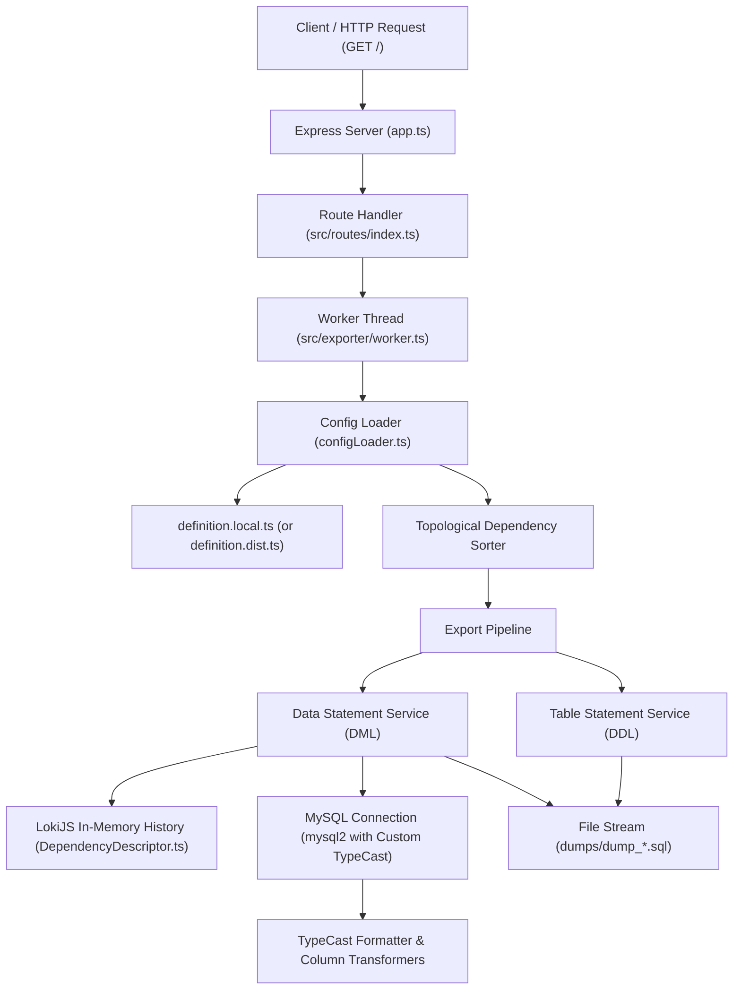

# AGENTS.md - Developer & AI Agent Guide for DB Dumper

## Overview

**DB Dumper** is a TypeScript-based Node.js application and HTTP service designed to export sanitized and filtered MySQL database dumps. It allows selective schema and data dumping, relational dependency resolution for data filtering, and column-level data transformation/masking (e.g., anonymizing PII before sharing database dumps).

---

## Architecture & Data Flow



### 1. HTTP Server & Worker Dispatch (`app.ts`, `src/routes/index.ts`)
- An Express server listens on port 3000 (default).
- Endpoint `GET /` starts a background task running in a Node.js `Worker` thread (`src/exporter/worker.ts`).
- Prevents concurrent export tasks: if a task UUID is active, it returns HTTP `429 Too Many Requests`. Otherwise, it returns HTTP `202 Accepted` with the task UUID.
- `GET /favicon.ico` returns HTTP `204 No Content`.

### 2. Configuration & Topological Sorting (`src/exporter/config/`)
- **`configLoader.ts`**: Dynamically imports `#root/definition.local`, falling back to `#root/definition.dist` if not found.
- Analyzes table dependencies declared in the configuration.
- Executes topological sorting using dependency graph in-degree calculation so parent tables are exported before child/dependent tables.
- **`types.ts`**: Defines TypeScript interfaces and enums for export configuration:
  - `ExportTypes`: `STRUCTURE_ONLY` (`0`), `DATA` (`1`).
  - `Connector`: `'AND'`, `'OR'`, `'IN'`.
  - `Where`: `{ condition: string, connector: Connector }`.
  - `Dependency`: `{ table: string, column: string }`.
  - `ConfigObject`: Configuration for an individual table.
  - `ImportDefinition`: Array of `ConfigObject`.

### 3. Dependency Tracking & Subquery Generation (`src/exporter/DependencyDescriptor.ts`)
- Uses an in-memory **LokiJS** database (`history` collection).
- When a parent table is queried with specific `WHERE` or `LIMIT` clauses, the exact query is saved with `saveHistory(table, query)`.
- When child/dependent tables are processed, `getJoinForDependency(agentTable, table, primaryColumn)` generates an `INNER JOIN (<parent_subquery>) as sub_<table_name> ON sub_<table_name>.<column> = <agentTable>.<column>`, ensuring only data related to exported parent records is included in the dump.

### 4. Database Connection & Value Transformations (`src/exporter/db.ts`, `src/exporter/formatter.ts`)
- Uses `mysql2` (and promise wrapper).
- Configures custom `typeCast` on the connection:
  - `BIT`: reads unsigned 8-bit integer buffer.
  - `VAR_STRING`: replaces `'0000-00-00 00:00:00'` placeholders with `'CURRENT_TIMESTAMP'`.
  - `TIMESTAMP`: normalizes to standard ISO SQL format `YYYY-MM-DD HH:mm:ss`.
  - Other types: checks if the table/column has a transformer configured in the table definition. If so, applies the transformer function and formats string quotes appropriately (handles `DEFAULT` and `null` without stringification).

### 5. DDL & DML Generation (`src/service/`)
- **`TableStatementService.ts`**: Runs `SHOW CREATE TABLE <table>` for each configured table and writes the DDL statement to the output stream.
- **`DataStatementService.ts`**: Builds `SELECT * FROM <table> [JOINs] [WHERE] [LIMIT]`, executes it, and writes `INSERT INTO <table> VALUES (...)` batches to the dump file.
- **`FileService.ts`**: Opens an append stream (`dumps/dump_<DD_MM_YYYY>_<uuid_prefix>.sql`), closes it upon completion, or removes the partial file on error via `removeDump()`.

---

## Directory Structure

```
db_dumper/
├── .env.dist                   # Sample environment configuration for MySQL connection
├── .gitignore                  # Git ignore rules (dumps, node_modules, definition.local.ts, etc.)
├── .initdb/                    # Initial database SQL schema/seed for Docker testing
│   └── test.sql
├── .prettierrc                 # Prettier configuration (singleQuote, trailingComma: none, no semi)
├── app.ts                      # Express server entry point
├── bun.lockb                   # Bun lockfile
├── definition.dist.ts          # Default/example export configuration template
├── docker-compose.yml          # Local MySQL test container configuration
├── dumps/                      # Destination directory for generated SQL dumps (.gitkeep)
├── eslint.config.mjs           # Flat ESLint configuration
├── package.json                # Project dependencies and npm scripts
├── src/
│   ├── exporter/
│   │   ├── DependencyDescriptor.ts # LokiJS query history & INNER JOIN subquery generation
│   │   ├── db.ts               # MySQL connection provider with custom typeCast hook
│   │   ├── formatter.ts        # Custom typeCast function and transformer execution logic
│   │   ├── worker.ts           # Worker thread script executing export workflow
│   │   └── config/
│   │       ├── configLoader.ts # Configuration importer and topological dependency sorter
│   │       └── types.ts        # TypeScript types (ExportTypes, ConfigObject, etc.)
│   ├── routes/
│   │   └── index.ts            # Express router: GET / initiates export worker
│   ├── service/
│   │   ├── DataStatementService.ts  # SELECT query builder, runner, and INSERT statement writer
│   │   ├── FileService.ts           # Dump file stream creation, management, and cleanup
│   │   └── TableStatementService.ts # SHOW CREATE TABLE execution and DDL writer
│   ├── transformer/
│   │   ├── generalTransformer.ts    # Built-in generic transformers (setToNull, setToDefault, toIsoDate)
│   │   └── textTransformers.ts       # Built-in text transformers (maskText)
│   └── types.d.ts              # Ambient module declarations for configuration files
└── tsconfig.json               # TypeScript compiler configuration (subpath imports #src/*, #root/*)
```

---

## Key Configurations & Conventions

### Subpath Imports
The project uses TypeScript / Node subpath imports configured in `tsconfig.json` and `package.json`:
- `#src/*` -> `./src/*.ts`
- `#root/*` -> `./*.ts`

Always use subpath imports when importing across modules (e.g. `import { ExportTypes } from '#src/exporter/config/types'`).

### Code Style & Linting
- **Prettier**: Single quotes, no semicolons, no trailing commas.
- **ESLint**: Flat config (`eslint.config.mjs`) extending `@eslint/js` and `typescript-eslint`.
- Avoid unused variables, avoid implicit any types, maintain existing comments and docstrings.

---

## Typical Development Workflows

### 1. Starting the Test Database
```bash
docker compose up -d
```
Populates a MySQL instance on `localhost:3306` with the sample tables and data in `.initdb/test.sql`.

### 2. Environment Setup
Copy `.env.dist` to `.env`:
```dotenv
HOST=127.0.0.1
DB_USER=root
DB_PASSWORD=root
TARGET_DB=db
```

### 3. Creating Export Definition
Create `definition.local.ts` in the project root:
```typescript
import { ExportTypes, ImportDefinition } from '#src/exporter/config/types'
import { setToDefault, setToNull } from '#src/transformer/generalTransformer'
import { maskText } from '#src/transformer/textTransformers'

const config: ImportDefinition = [
  {
    table: 'users',
    type: ExportTypes.DATA,
    limit: 50,
    columns: {
      firstName: maskText,
      lastName: maskText
    }
  },
  {
    table: 'items',
    type: ExportTypes.DATA,
    dependencies: [
      { table: 'users', column: 'userId' }
    ]
  },
  {
    table: 'roles',
    type: ExportTypes.STRUCTURE_ONLY
  }
]

export default config
```

### 4. Running the Application
- **Development (with hot reloading)**:
  ```bash
  npm run dev
  ```
- **Production / Direct Start**:
  ```bash
  npm run build
  npm start
  ```
- **Trigger Export**:
  ```bash
  curl http://localhost:3000/
  ```
- Generated dumps will be created in `dumps/dump_<date>_<uuid>.sql`.

### 5. Formatting and Linting
```bash
npm run format
npm run lint
npm run lint:fix
```

---

## Guidelines for AI Agents Making Modifications

1. **Adding New Transformers**:
   - Place generic transformers in `src/transformer/generalTransformer.ts` and text/string transformers in `src/transformer/textTransformers.ts`.
   - Ensure transformers accept the raw column value and return either a transformed value, `'DEFAULT'`, or `null`.
   - String values are automatically quoted by `formatter.ts` unless they equal `'DEFAULT'` or `null`.

2. **Modifying Query & Dependency Logic**:
   - `DependencyDescriptor.ts` assumes the parent table query in `history` has the format `SELECT * FROM ...`. If changing the SELECT column projection, ensure `subSelect` replacements in `getJoinForDependency` match the schema.
   - When modifying `_createQuery` in `DataStatementService.ts`, check that table alias references match generated JOIN subqueries (`sub_<table_name>`).

3. **Handling File Streams & Async Execution**:
   - The export process runs in a dedicated worker thread (`worker.ts`) communicating over `parentPort`.
   - If introducing multi-file dumping, zip compression, or remote S3 upload, ensure errors trigger `removeDump()` or proper cleanup in `errorHandler`.

4. **Preserving Type Definitions**:
   - If extending `ConfigObject` or `ExportTypes` in `src/exporter/config/types.ts`, update `definition.dist.ts`, `src/types.d.ts`, and `README.md` to keep documentation and typing consistent.
