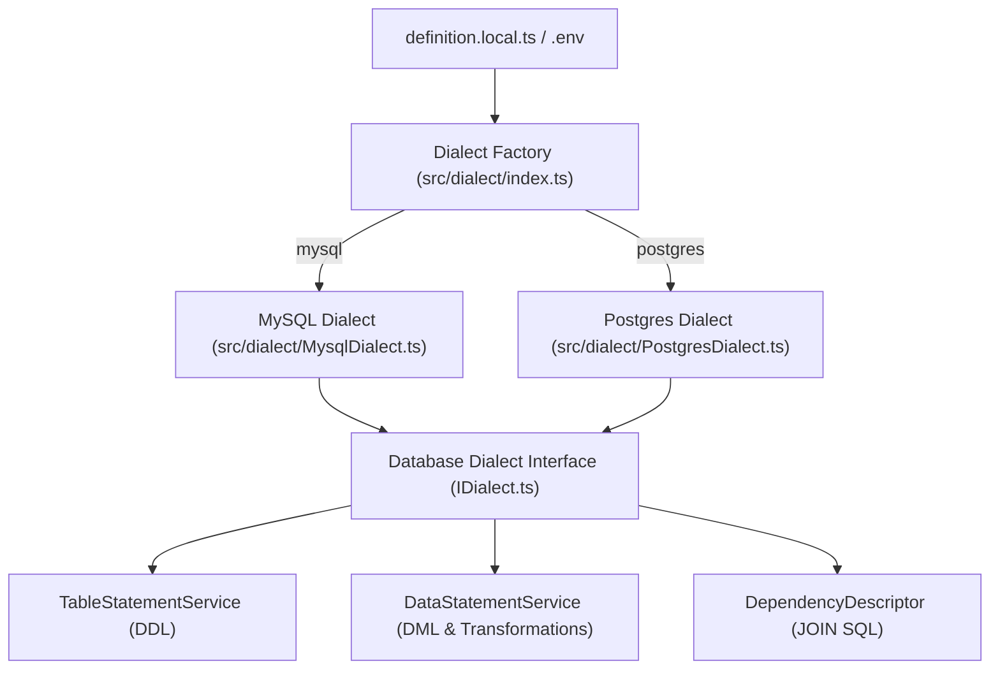

# Implementation Plan: PostgreSQL Support & Database Dialect Abstraction

This plan prepares **DB Dumper** to export from both **PostgreSQL** and **MySQL** by introducing a database dialect abstraction layer for connections, DDL extraction, identifier quoting, type casting/transformation, and foreign key constraint handling.

---

## User Review Required

> [!IMPORTANT] > **PostgreSQL DDL Generation Strategy**: Unlike MySQL's `SHOW CREATE TABLE`, PostgreSQL does not have a native single-command DDL generator. We propose a pure SQL schema introspector querying `pg_catalog` / `information_schema` to construct `CREATE TABLE` DDL with constraints, sequences, and default values without requiring external CLI binaries like `pg_dump`.

> [!IMPORTANT] > **Sequence Synchronization**: PostgreSQL `SERIAL` / `IDENTITY` columns require sequence value updates after importing explicit IDs (e.g., `SELECT setval(...)`). The PostgreSQL dialect will append sequence synchronization queries at the end of data statements.

---

## Open Questions

- **Configuration Selection**: Should the database engine be selected globally via `.env` (`DB_DIALECT=mysql | postgres`), or should the export definition (`definition.local.ts`) allow per-definition dialect overrides? _(Default recommendation: Support `DB_DIALECT` in `.env` with fallback to `mysql` for backwards compatibility)._
- **Session Replication Privileges**: For disabling foreign key checks during import, PostgreSQL uses `SET session_replication_role = 'replica';`. If the target user lacks superuser permissions, should we also support alternative FK management (such as topological DDL ordering or deferred constraints)?

---

## Proposed Architectural Changes



---

## Component Breakdown

### 1. Dependencies & Database Drivers

#### `package.json`

- Add `pg` (`^8.13.0`) and `@types/pg` (`^8.11.0`) for PostgreSQL connectivity.

---

### 2. Database Dialect Abstraction Layer (`src/dialect/`)

#### `src/dialect/IDialect.ts`

Define the unified interface for all database engines:

```typescript
export interface IDialect {
  readonly name: 'mysql' | 'postgres'
  getConnection(): Promise<any>
  closeConnection(): Promise<void>
  query<T>(sql: string): Promise<T[]>

  // DDL & Constraint Headers/Footers
  getHeaderStatements(): string
  getFooterStatements(definition: ImportDefinition): Promise<string>
  getTableDDL(tableName: string): Promise<string>

  // Identifier & Literal Formatting
  quoteIdentifier(identifier: string): string
  escapeString(value: string): string
  formatValue(value: unknown, columnName?: string, tableName?: string): string

  // Joins & Selects
  buildSelectQuery(
    config: ConfigObject,
    joins: string,
    where: string,
    limit: string
  ): string
  buildJoinSubquery(
    parentTable: string,
    parentCol: string,
    childTable: string,
    childCol: string,
    subSelect: string
  ): string
}
```

#### `src/dialect/MysqlDialect.ts`

- Encapsulate `mysql2` connection lifecycle, `SHOW CREATE TABLE`, backtick quoting (`` `name` ``), and `SET FOREIGN_KEY_CHECKS` headers/footers.

#### `src/dialect/PostgresDialect.ts`

- Implement `pg` pool/client connection handling.
- **DDL Introspection**: Query `pg_catalog.pg_attribute`, `pg_type`, `pg_constraint`, `pg_class`, and `information_schema` to construct PostgreSQL `CREATE TABLE "table" (...)` statements with correct data types, defaults, and primary/foreign keys.
- **Double-Quote Identifiers**: Format identifiers as `"table"` and `"column"`.
- **Foreign Key Constraints**: Header: `SET session_replication_role = 'replica';`, Footer: `SET session_replication_role = 'origin';`.
- **Sequence Reset Queries**: Generate `SELECT setval(pg_get_serial_sequence('table', 'id'), COALESCE(MAX(id), 1), MAX(id) IS NOT NULL) FROM "table";` for identity/serial columns.

#### `src/dialect/index.ts`

- Dialect factory to instantiate and cache the selected dialect based on `process.env.DB_DIALECT || 'mysql'`.

---

### 3. Engine-Agnostic Transformation Layer

#### `src/exporter/formatter.ts`

- Decouple column transformer execution from the `mysql2` driver-specific `typeCast` hook.
- Standardize row transformation into a reusable transformer pipeline that executes on raw row objects across both MySQL and Postgres dialects.

---

### 4. Query Generation & Statement Services

#### `src/exporter/DependencyDescriptor.ts`

- Use `dialect.quoteIdentifier()` and `dialect.buildJoinSubquery()` so inner join subqueries adapt to MySQL (backticks) or Postgres (double quotes).

#### `src/service/TableStatementService.ts`

- Delegate DDL generation to `dialect.getTableDDL(table)` and `dialect.getHeaderStatements()`.

#### `src/service/DataStatementService.ts`

- Format `INSERT INTO <quoted_table> (<quoted_columns>) VALUES (...)` with dialect-specific column/table quoting and literal escaping.

#### `src/exporter/worker.ts`

- Append `dialect.getFooterStatements(definition)` at the end of the dump stream.

---

### 5. Local Docker & Environment Setup

#### `docker-compose.yml`

- Add a `postgres:latest` service running on port `5432` alongside the existing MySQL container.

#### `.initdb/postgres_test.sql`

- Seed data and schema for testing PostgreSQL exports (`users`, `roles`, `user_roles`, `items`).

#### `.env.dist`

- Add `DB_DIALECT`, `PORT`, and standard PostgreSQL configuration parameters.

---

## Verification Plan

### Automated / Code Validation

- Install `pg` & `@types/pg` and verify clean TypeScript compilation (`tsc --noEmit`).
- Verify ESLint and Prettier compliance across all newly created and updated files.

### Integration Verification

1. **MySQL Export Verification**:
   - Run `docker compose up -d db`.
   - Execute dump with `DB_DIALECT=mysql` and verify dump output matches expected MySQL syntax.
2. **PostgreSQL Export Verification**:
   - Run `docker compose up -d postgres`.
   - Execute dump with `DB_DIALECT=postgres` and verify dump output:
     - Generates valid PostgreSQL `CREATE TABLE "table"` DDL.
     - Formats double-quoted identifiers and single-quoted string literals.
     - Includes `session_replication_role` constraints and `setval()` sequence resets.
     - Successfully imports into a clean PostgreSQL database (`psql -f dump.sql`).
